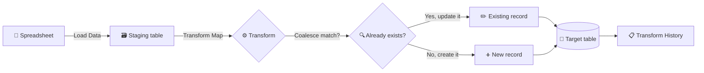

# 📊 Importing Spreadsheet Data with Transform Maps in ServiceNow


Hi there! 👋 This repository documents our project for the ServiceNow System Administrator course. It walks through how we took a plain spreadsheet, pushed its rows into ServiceNow, and turned them into real, usable records. If you're new to ServiceNow, don't worry. We've tried to explain every step the way we wished someone had explained it to us.

---

## 📑 Contents

- [🌱 Why we built this](#-why-we-built-this)
- [👥 The team](#-the-team)
- [🗺️ The big picture](#️-the-big-picture)
- [🔄 How the import works, step by step](#-how-the-import-works-step-by-step)
- [🧰 What we used](#-what-we-used)
- [🗂️ How the project is organised](#️-how-the-project-is-organised)
- [🛠️ Doing it yourself](#️-doing-it-yourself)
- [🧠 The ideas behind it](#-the-ideas-behind-it)
- [✍️ Writing transform scripts](#️-writing-transform-scripts)
- [👀 What you'll see after a run](#-what-youll-see-after-a-run)
- [🧪 Testing](#-testing)
- [🐞 When things go wrong](#-when-things-go-wrong)
- [💭 What we learned](#-what-we-learned)
- [🔮 What we'd like to try next](#-what-wed-like-to-try-next)

---

## 🌱 Why we built this

Picture a list of 300 employees sitting in an Excel file. Someone needs them all in ServiceNow by Monday. You could type each one in by hand, which would take days and almost certainly introduce typos. Or you could load the file once and let the platform do the heavy lifting.

That second option is what this project is about. ServiceNow has a built-in import tool, and our job was to understand it well enough to use it safely: load the data, decide where each column should go, skip the rows that don't belong, and avoid creating the same person twice when the file is updated later.

It sounds simple, and in many ways it is. The details are where the learning happens. 🙂

---

## 👥 The team

| 👤 Name | 🎖️ Role |
|---------|---------|
| **B. Ajithram** | 👑 Team Leader |
| **M. Shahul Hamed** | 🤝 Team Member |

We're both third-year B.E. Computer Science and Engineering students at **Latha Mathavan Engineering College**, Madurai. Ajithram coordinated the work and kept the project moving, while Shahul focused on testing the mappings and checking results. We swapped roles often, because explaining a step to someone else is the fastest way to find out whether you really understood it.

---

## 🗺️ The big picture

Here's the whole journey in one diagram. Read it from left to right and you'll have the core idea.



The key idea is that ServiceNow never writes your spreadsheet straight into the live tables. It first drops the raw rows into a staging table, so you can inspect them, and only then moves them across using rules you control.

---

## 🔄 How the import works, step by step

### 1️⃣ Get the spreadsheet ready 📝

Before touching ServiceNow, take a moment to tidy the file. Make sure the first row holds clear column names like `first_name` or `email`. Remove merged cells and blank rows, and save the file as CSV if you can. CSV is the simplest format and the least likely to cause surprises.

### 2️⃣ Load it into an import set 📤

In ServiceNow, go to **System Import Sets → Load Data**, upload your file, and give the import a table label. ServiceNow creates a staging table and places every row inside it, untouched. This is your safety net. Whatever happens next, the original data is still there.

### 3️⃣ Create a transform map 🗺️

Next, go to **System Import Sets → Transform Maps** and create a new one. Tell it where the data is coming from (the staging table) and where it should go (for example, the Users table). Think of the transform map as the instructions for the move.

### 4️⃣ Connect the columns to the fields 🔗

This is where you tell ServiceNow that the `email` column belongs in the Email field, and so on. The **Auto Map Matching Fields** button saves time when names match. For anything left over, map it by hand.

You'll also pick a **coalesce** field. We'll explain this one in more detail below, because it's the part that saves you from duplicate records.

### 5️⃣ Add scripts if you need them 🧪

Sometimes a straight copy isn't enough. Maybe some rows lack an email, or names arrive in the wrong case. Transform scripts let you handle these cases. You don't need them for every import, but they're extremely useful when the data isn't perfect, which is most of the time.

### 6️⃣ Run the transform ▶️

Open the transform map, click **Transform**, and let ServiceNow work through the rows. For a small file, it's over almost immediately.

### 7️⃣ Check what happened ✅

Look at the transform history to see how many rows were created, updated, skipped, or rejected. Then open the target table and check a few records yourself. Trust the numbers, but verify with your own eyes too.

---

## 🧰 What we used

- 🌐 **ServiceNow** (a Personal Developer Instance for practice)
- 📑 **Import Sets and Transform Maps** for the core workflow
- 🟨 **JavaScript** for transform scripts
- 📊 **Excel or Google Sheets** to prepare sample data
- 🧾 **CSV files** as the input format
- 🐙 **GitHub** to share the project

---

## 🗂️ How the project is organised

```
📦 import-data-transform-maps/
├── 📖 README.md               ➜ You are here
├── 📂 data/
│   ├── 📄 sample_users.csv    ➜ Clean sample data
│   └── 📄 test_cases.csv      ➜ Rows with deliberate problems
├── 📂 scripts/
│   ├── 🧪 onBefore_validation.js
│   └── 🧪 onComplete_summary.js
├── 📂 docs/
│   └── 🖼️ screenshots/        ➜ Screenshots from each step
└── 📂 reports/
    └── 📋 test_results.md     ➜ What happened during testing
```

> 📌 Adjust this layout to match the files you actually have.

---

## 🛠️ Doing it yourself

You'll need a ServiceNow developer instance (you can request a free Personal Developer Instance from the ServiceNow developer site), a user account with admin rights, and a sample file. Basic JavaScript helps for the scripting parts, but you can follow the main workflow without it.

### Try a small example

Create a file called `sample_users.csv` with this content:

```csv
first_name,last_name,user_name,email,department,active
Ajithram,B,ajithram.b,ajithram@example.com,IT,true
Shahul,Hamed,shahul.hamed,shahul@example.com,IT,true
Test,User,test.user,,HR,true
Duplicate,Row,ajithram.b,ajithram@example.com,IT,true
```

We deliberately put two problems in this file. One row has no email address, and one `user_name` appears twice. That's on purpose. It's the quickest way to see validation and coalescing working.

Load the file, map the columns, set coalesce on `user_name`, and run the transform. You should end up with two new users, one row skipped for the missing email, and the duplicate row updating the first user instead of creating a second one.

---

## 🧠 The ideas behind it

### 🗃️ Import sets
An import set is the staging area. Each column in your file becomes a field, and the data sits there as-is until a transform map moves it. Think of it as an inbox you can check before anything is filed away.

### 🗺️ Transform maps
A transform map is the rulebook. It says which columns go where, which field identifies a record, and which scripts should run along the way.

### 🔑 Coalesce
Coalesce is the trick that keeps your data clean over time. You choose one field that uniquely identifies a record, such as a username. When the import runs, ServiceNow checks whether that value already exists. If it does, the record is updated. If it doesn't, a new one is created.

Without coalesce, running the same file twice would give you every record twice. We learned this the slightly annoying way during testing, and it's now the first thing we check.

### 🧪 Transform scripts

| ⏱️ Script | 🕐 When it runs | 💡 What it's good for |
|----------|----------------|----------------------|
| `onStart` | At the beginning of the run | Setting things up |
| `onBefore` | Before each row is saved | Cleaning data or skipping rows |
| `onAfter` | After each row is saved | Logging or follow-up work |
| `onComplete` | When the whole run is done | Summaries |

---

## ✍️ Writing transform scripts

Transform scripts are written in JavaScript and use the Glide API. Here are a few we actually used.

### Skip rows without an email

```javascript
(function runTransformScript(source, map, log, target) {
    if (!source.u_email) {
        log.info('Skipped row ' + source.sys_row + ' because the email is missing');
        ignore = true;
    }
})(source, map, log, target);
```

### Capitalise first names

```javascript
(function runTransformScript(source, map, log, target) {
    if (source.u_first_name) {
        var name = source.u_first_name.toLowerCase();
        target.first_name = name.charAt(0).toUpperCase() + name.slice(1);
    }
})(source, map, log, target);
```

### Fill in a default department

```javascript
(function runTransformScript(source, map, log, target) {
    if (!source.u_department) {
        target.department = 'Unassigned';
    }
})(source, map, log, target);
```

> ⚠️ Try scripts on a development instance first. A small mistake in a script can affect many rows very quickly.

---

## 👀 What you'll see after a run

After each run, we checked three places. Each one tells you something different.

**📋 Transform history** gives you the overall picture. It shows the status of the run and how many rows were inserted, updated, skipped, or failed. If the numbers don't match what you expected, that's your first clue something needs attention.

**🗃️ The import set rows** show what happened to each individual row. A row marked as processed made it across. A skipped row was intentionally ignored by a script. A row with an error includes a message explaining why it failed, which is usually the fastest way to find the problem.

**🏢 The target table** is where you confirm the result. Open the Users list, search for a few of the names you imported, and check that the details look right.

Here's what we expected from our sample file:

| 🧪 Row | 📥 What it contains | 📤 What should happen |
|-------|---------------------|----------------------|
| 1 | Ajithram, `ajithram.b` | ➕ Created |
| 2 | Shahul, `shahul.hamed` | ➕ Created |
| 3 | Test User, no email | ⏭️ Skipped |
| 4 | Duplicate Row, `ajithram.b` | ✏️ Updated, not duplicated |

> 📸 Screenshots of the transform history and the Users list are saved in `docs/screenshots/`.

---

## 🧪 Testing

We tested the import in a few different ways, each targeting a specific risk. We kept a simple log of each test in `reports/test_results.md`.

- ✅ **Clean file:** Does a well-formed file load and transform correctly?
- ✅ **Mapping check:** Does every column land in the right field?
- ✅ **Re-run:** Does running the same file again update records instead of duplicating them?
- ✅ **Missing data:** Are rows without an email skipped as intended?
- ✅ **Bad format:** Does a malformed value produce a clear error in the staging row?
- ✅ **Counts:** Do the history totals match the number of rows in the file?

Your own results may differ, so update the report with what you actually see.

---

## 🐞 When things go wrong

Things went wrong for us too, so here's what usually caused the trouble.

| ❗ What you notice | 🔍 Usually caused by | 🛠️ What to try |
|-------------------|---------------------|---------------|
| Nothing changes after the transform | A column isn't mapped | Check the field maps list |
| Duplicate users appear | Coalesce isn't set | Set coalesce on a unique field |
| Some values are blank | Column name doesn't match exactly | Check spelling and case |
| Dates fail to import | Date format is unexpected | Save dates as `YYYY-MM-DD` |
| A script seems to do nothing | Syntax error in the script | Check the system log |
| The import is very slow | File is very large | Split it into smaller files |

---

## 💭 What we learned

Working on this project changed how we think about data. Before, a spreadsheet was just a file. Now we see it as a set of rules waiting to be applied. We learned to prepare data before loading it, to design mappings that stay correct when a file is re-imported, and to read logs carefully instead of assuming a run worked.

We also noticed how much the coding we study in class applies here. Loops, conditions, and clean variable handling show up in transform scripts more often than we expected. Bridging classroom programming and a real enterprise platform was one of the most satisfying parts of the project.

---

## 🔮 What we'd like to try next

- ⏰ Scheduling imports so the data updates on its own
- 🌐 Pulling data from an external source instead of a file
- 📧 Sending an email when a run finishes
- 📊 Building a small dashboard to track import history
- 🛡️ Adding stricter checks for email and phone formats

---

<div align="center">

🙏 Thanks for reading! If you have questions or suggestions, feel free to open an issue.

🧑‍💻 **B. Ajithram** (Team Leader) &nbsp;·&nbsp; 🧑‍💻 **M. Shahul Hamed**
🎓 Latha Mathavan Engineering College · CSE, 3rd Year

</div>
