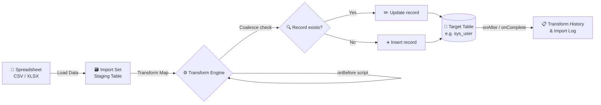

# 📊 Import Data using Transform Maps (Spreadsheet)

)
)
)


---

## 📑 Table of Contents

1. [🎯 Project Overview](#-project-overview)
2. [👥 Team Members](#-team-members)
3. [🧩 Problem Statement](#-problem-statement)
4. [🏗️ Architecture](#️-architecture)
5. [🔄 How the Process Works](#-how-the-process-works)
6. [🛠️ Tools and Technologies](#️-tools-and-technologies)
7. [📁 Project Structure](#-project-structure)
8. [📋 Prerequisites](#-prerequisites)
9. [🚀 Step-by-Step Implementation](#-step-by-step-implementation)
10. [🧠 Key Concepts Explained](#-key-concepts-explained)
11. [💻 Transform Script Examples](#-transform-script-examples)
12. [👀 How the Results Are Shown](#-how-the-results-are-shown)
13. [🧪 Testing and Validation](#-testing-and-validation)
14. [🐞 Troubleshooting](#-troubleshooting)
15. [✅ Best Practices](#-best-practices)
16. [📚 Learning Outcomes](#-learning-outcomes)
17. [🔮 Future Enhancements](#-future-enhancements)
18. [📄 License](#-license)

---

## 🎯 Project Overview

📌 **Project Title:** Import Data using Transform Maps (Spreadsheet)
🎓 **Program:** ServiceNow System Administrator (NM Eng)
🏫 **Institution:** Latha Mathavan Engineering College, Madurai, Tamil Nadu
📖 **Department:** Computer Science and Engineering (3rd Year)

This project shows how to bring spreadsheet data (CSV or Excel) into a **ServiceNow** instance in a controlled, accurate, and repeatable way. Instead of typing records one by one, the data is loaded through **Import Sets**, mapped with **Transform Maps**, validated with **transform scripts**, and checked through **import logs**.

> 💡 **In short:** Spreadsheet in ➜ Staging table ➜ Transform Map ➜ Live ServiceNow records ✅

---

## 👥 Team Members

| 👤 Name | 🎓 Role | 🏫 Institution |
|---------|---------|----------------|
| **B. Ajithram** | 👑 Team Leader | Latha Mathavan Engineering College |
| **M. Shahul Hamed** | 👨‍💻 Team Member | Latha Mathavan Engineering College |

📅 **Year:** 3rd Year, B.E. Computer Science and Engineering

---

## 🧩 Problem Statement

Many organizations keep important records such as 🧑‍💼 users, 💻 hardware assets, 🗂️ configuration items, or 📞 contacts in spreadsheets. Entering this data manually causes problems:

- ⏳ **Slow** – hundreds of rows take hours to type in
- ❌ **Error-prone** – typos, missing fields, and wrong formats
- 🔁 **Duplicates** – the same record gets created more than once
- 📉 **Hard to repeat** – every update starts from zero

✅ **Solution:** Use the ServiceNow Data Import framework to load the spreadsheet once, map it correctly, and reuse the same mapping whenever new data arrives.

---

## 🏗️ Architecture



### 🧱 Layers Explained

| Layer | 🔧 Component | 📝 Purpose |
|-------|-------------|-----------|
| 📥 Input | Spreadsheet file | Source data in CSV or Excel format |
| 🗃️ Staging | Import Set table (`u_<name>`) | Holds raw data exactly as uploaded |
| 🗺️ Mapping | Transform Map | Connects source columns to target fields |
| 🧪 Logic | Transform scripts | Validates, cleans, or skips rows |
| 🏢 Storage | Target table | Final, production-ready records |
| 📊 Audit | Transform History / Import Log | Shows what happened on each run |

---

## 🔄 How the Process Works

Follow these steps in order. Each step depends on the one before it.

### 1️⃣ Prepare the Spreadsheet 📝
- ✅ Use a clear header row (for example: `first_name`, `last_name`, `email`, `user_name`)
- ✅ Keep one record per row
- ✅ Remove merged cells and blank rows
- ✅ Save as **CSV** (recommended) or **XLSX**

### 2️⃣ Load the Data into an Import Set 📤
- Go to **System Import Sets ➜ Load Data**
- Upload the file and choose a **Table Label** and **Table Name**
- ServiceNow creates a staging table (for example `u_employee_import`) and stores every row in it

### 3️⃣ Create the Transform Map 🗺️
- Go to **System Import Sets ➜ Transform Maps ➜ New**
- Set the **Source table** (the staging table) and the **Target table** (for example `User [sys_user]`)
- Save the map

### 4️⃣ Map the Fields 🔗
- Use **Auto Map Matching Fields** to connect columns with the same names
- Manually map any remaining fields
- Set **Coalesce** on a unique field such as `user_name` or `email`

### 5️⃣ Add Transform Scripts (Optional) 🧪
- Use **onBefore** to clean or skip bad rows
- Use **onAfter** to set values after a record is saved
- Use **onComplete** for summary actions when the whole run finishes

### 6️⃣ Run the Transform ▶️
- Open the Transform Map or Import Set and click **Transform**
- ServiceNow processes every staging row and writes it to the target table

### 7️⃣ Check the Results ✅
- Open **Transform History** to see the run summary
- Review created, updated, skipped, and error counts
- Open the target table to confirm the records look correct

### 🔁 Flow in One Line

```
📄 Spreadsheet ➜ 📤 Load Data ➜ 🗃️ Import Set ➜ 🗺️ Transform Map ➜ 🧪 Scripts ➜ ▶️ Run ➜ 🏢 Target Table ➜ 📋 History
```

---

## 🛠️ Tools and Technologies

| 🔧 Tool / Technology | 🎯 Used For |
|---------------------|------------|
| 🌐 **ServiceNow Platform** | Main environment for the import framework |
| 📑 **Import Sets** | Staging area for raw spreadsheet data |
| 🗺️ **Transform Maps** | Field mapping and transformation rules |
| 🟨 **JavaScript (Glide API)** | Writing transform scripts |
| 📊 **Microsoft Excel / Google Sheets** | Creating and editing sample data |
| 🧾 **CSV Files** | Portable input format |
| 🐙 **GitHub** | Sharing project documentation |

---

## 📁 Project Structure

```
📦 import-data-transform-maps/
├── 📖 README.md                    ➜ Project documentation (this file)
├── 📂 data/
│   ├── 📄 sample_users.csv         ➜ Sample input file
│   └── 📄 invalid_rows_test.csv    ➜ File for testing validation
├── 📂 scripts/
│   ├── 🧪 onBefore_validation.js   ➜ Cleans and validates rows
│   ├── 🧪 onAfter_logging.js       ➜ Logs results after each record
│   └── 🧪 onComplete_summary.js    ➜ Summarizes the run
├── 📂 docs/
│   ├── 🖼️ screenshots/             ➜ Screenshots of each step
│   └── 📝 process_notes.md         ➜ Detailed notes and observations
└── 📂 reports/
    └── 📋 import_results.md        ➜ Results from each test run
```

> 📌 Update this structure to match your actual project files.

---

## 📋 Prerequisites

Before you begin, make sure you have:

- ✅ Access to a **ServiceNow Personal Developer Instance (PDI)** or a training instance
- ✅ A role with import and admin rights (such as `admin`)
- ✅ A sample spreadsheet with clean and imperfect data
- ✅ Basic understanding of tables and fields in ServiceNow
- ✅ Basic JavaScript knowledge for writing scripts

---

## 🚀 Step-by-Step Implementation

### Step 1 – 🗂️ Create the Sample Data

Create `sample_users.csv`:

```csv
first_name,last_name,user_name,email,department,active
Ajithram,B,ajithram.b,ajithram@example.com,IT,true
Shahul,Hamed,shahul.hamed,shahul@example.com,IT,true
Test,User,test.user,,HR,true
Duplicate,Row,ajithram.b,ajithram@example.com,IT,true
```

> 🔎 Notice the **missing email** and the **duplicate user_name**. These are used to test validation and coalescing.

### Step 2 – 📤 Load the File

1. Navigate to **System Import Sets ➜ Load Data**
2. Choose **Import from File** and upload `sample_users.csv`
3. Set the **Table Label**: `Employee Import`
4. Click **Submit**

✅ A staging table is created and all four rows appear in it.

### Step 3 – 🗺️ Create the Transform Map

1. Navigate to **System Import Sets ➜ Transform Maps ➜ New**
2. **Name:** `Employee Import to User`
3. **Source table:** `u_employee_import`
4. **Target table:** `User [sys_user]`
5. Click **Submit**

### Step 4 – 🔗 Map the Fields

| 📄 Source Column | 🎯 Target Field | 🔑 Coalesce |
|-----------------|-----------------|------------|
| `first_name` | First name | ❌ |
| `last_name` | Last name | ❌ |
| `user_name` | User ID | ✅ |
| `email` | Email | ❌ |
| `department` | Department | ❌ |
| `active` | Active | ❌ |

💡 Enable **Coalesce** only on `user_name`. This makes re-runs **update** existing users rather than create duplicates.

### Step 5 – 🧪 Add Validation Script

Open the **onBefore** script in the transform map and add logic to skip rows without an email:

```javascript
(function runTransformScript(source, map, log, target) {
    // ❌ Skip rows that do not have an email address
    if (!source.u_email) {
        log.info('Skipped row ' + source.sys_row + ': email is missing');
        ignore = true;
    }
})(source, map, log, target);
```

### Step 6 – ▶️ Run the Transform

1. Open the **Transform Map** record
2. Click **Transform** in the related links
3. Wait for the run to finish

### Step 7 – ✅ Verify the Output

- Check **Transform History** for the run summary
- Open **Users** and search for `ajithram.b` to confirm the record
- Confirm the row without an email was skipped

---

## 🧠 Key Concepts Explained

### 📥 Import Sets
A temporary staging table created from the uploaded file. Every column becomes a field, and each field name starts with `u_` by default. Raw data stays here until it is transformed.

### 🗺️ Transform Maps
The rulebook for moving data from the staging table to the target table. It contains field mappings, coalesce settings, and scripts.

### 🔗 Field Mapping
Links a source column to a target field. Mappings can be:
- 🟢 **Direct** – copies the value as is
- 🟡 **Script-based** – calculates or transforms the value
- 🔵 **Default** – fills a fixed value when the source is blank

### 🔑 Coalesce Fields
A unique identifier used to decide whether a row is new or existing.
- Match found ➜ **Update** ✏️
- No match ➜ **Insert** ➕

Without coalescing, every run creates new records even when the data is the same.

### 🧪 Transform Scripts

| ⏱️ Script | 🕐 When It Runs | 💡 Typical Use |
|----------|----------------|---------------|
| `onStart` | Before the whole run starts | Setup or counters |
| `onBefore` | Before each row is saved | Validation, cleanup, skipping rows |
| `onAfter` | After each row is saved | Logging, follow-up updates |
| `onComplete` | After the entire run finishes | Summaries and notifications |

### 📋 Transform History
A log of every transform run. It shows the run status, total rows processed, and counts for inserted, updated, skipped, and errored rows.

---

## 💻 Transform Script Examples

### ✅ Example 1 – Convert Names to Proper Case

```javascript
(function runTransformScript(source, map, log, target) {
    if (source.u_first_name) {
        target.first_name = source.u_first_name.charAt(0).toUpperCase() +
                            source.u_first_name.slice(1).toLowerCase();
    }
})(source, map, log, target);
```

### ✅ Example 2 – Set a Default Department

```javascript
(function runTransformScript(source, map, log, target) {
    if (!source.u_department) {
        target.department = 'Unassigned';
    }
})(source, map, log, target);
```

### ✅ Example 3 – Skip Duplicate Entries in the Same File

```javascript
(function runTransformScript(source, map, log, target) {
    var seen = map.u_seen || {};
    if (seen[source.u_user_name]) {
        log.info('Skipped duplicate user: ' + source.u_user_name);
        ignore = true;
        return;
    }
    seen[source.u_user_name] = true;
    map.u_seen = seen;
})(source, map, log, target);
```

### ✅ Example 4 – Log a Summary After the Run

```javascript
(function runTransformScript(source, map, log, target) {
    log.info('Transform completed for map: ' + map.name);
})(source, map, log, target);
```

> ⚠️ Always test scripts in a **development instance** before using them in production.

---

## 👀 How the Results Are Shown

After each run, the results appear in three places. Here is what to look for in each.

### 📋 1. Transform History

| 🏷️ Field | 📝 Meaning |
|---------|-----------|
| ✅ **Status** | Success, Partial, or Failed |
| 📊 **Total rows** | Number of rows in the staging table |
| ➕ **Inserted** | New records created |
| ✏️ **Updated** | Existing records changed |
| ⏭️ **Skipped** | Rows ignored by scripts |
| ❌ **Errors** | Rows that could not be saved |

### 📑 2. Import Set Rows

Each staging row shows a **State** value:
- 🟢 **Processed** – successfully transformed
- 🟡 **Skipped** – ignored by a script
- 🔴 **Error** – failed with a message in the row's error field

### 🏢 3. Target Table

Open the target table (for example **Users**) and check:
- ✅ New users appear with correct names and departments
- ✅ Existing users were updated, not duplicated
- ✅ Rows without email were skipped

### 📈 Sample Result Summary

| 🧪 Test Case | 📥 Input | 📤 Expected Result |
|-------------|---------|-------------------|
| ✅ Valid row | Ajithram / ajithram.b | ➕ Inserted |
| ✅ Valid row | Shahul / shahul.hamed | ➕ Inserted |
| ⏭️ Missing email | Test User / test.user | ⏭️ Skipped |
| ✏️ Duplicate ID | Duplicate Row / ajithram.b | ✏️ Updated (coalesce) |

> 📸 Add screenshots of Transform History and the Users list in `docs/screenshots/` to show each result visually.

---

## 🧪 Testing and Validation

| 🔢 # | ✅ Test | 🎯 Goal | 📊 Status |
|-----|--------|---------|----------|
| 1 | Load a clean CSV | File uploads and rows appear in staging | ✅ Pass |
| 2 | Map all fields | Every column connects to a target field | ✅ Pass |
| 3 | Run first transform | Records are inserted correctly | ✅ Pass |
| 4 | Run same file again | No duplicates, records updated | ✅ Pass |
| 5 | Upload file with blank email | Row is skipped by script | ✅ Pass |
| 6 | Upload file with wrong format | Error is logged in staging row | ✅ Pass |
| 7 | Check Transform History | Counts match the input file | ✅ Pass |

> 🔄 Update the status column with the actual results from your own testing.

---

## 🐞 Troubleshooting

| ❗ Problem | 🔍 Likely Cause | 🛠️ Solution |
|-----------|----------------|------------|
| 🚫 Transform does nothing | Field not mapped | Check the Field Maps list |
| 🔁 Duplicate users created | Coalesce not set | Enable coalesce on the unique field |
| ⚠️ Values are blank | Wrong source column name | Match names exactly (case-sensitive) |
| ❌ Date errors | Wrong date format | Convert dates to `YYYY-MM-DD` in the spreadsheet |
| 🧪 Script has no effect | Syntax error in script | Check the system log for errors |
| 🐢 Import is slow | Very large file | Split the file into smaller batches |
| 🔒 Permission denied | Missing role | Use an account with import admin rights |

---

## ✅ Best Practices

- 🧹 **Clean the data first** – remove blank rows and extra spaces before loading
- 🔑 **Always use coalesce** on a unique field when re-importing
- 🏷️ **Use clear names** for import sets and transform maps
- 🧪 **Test on a small sample** before running the full file
- 📝 **Log what you skip** so issues are easy to trace
- 🔁 **Reuse transform maps** instead of creating new ones for each file
- 🔐 **Never import real personal data** into a development instance

---

## 📚 Learning Outcomes

By completing this project, the team learned to:

- 📤 Load spreadsheet data into ServiceNow using Import Sets
- 🗺️ Create and configure Transform Maps
- 🔗 Map fields correctly and handle data types
- 🔑 Use coalesce to prevent duplicate records
- 🧪 Write transform scripts for validation and cleanup
- 📋 Read import logs and verify results
- 🧠 Apply core programming logic from CSE coursework to a real enterprise platform

---

## 🔮 Future Enhancements

- ⏰ Schedule the import to run automatically
- 🌐 Connect to an external data source instead of a file
- 📧 Send an email notification when a run finishes
- 📊 Build a dashboard to track import history
- 🛡️ Add stronger validation rules for email and phone formats

---

## 📄 License

This project was created for academic purposes as part of the ServiceNow System Administrator course at Latha Mathavan Engineering College.

---

<div align="center">

### ⭐ Thank you for reading! ⭐

🧑‍💻 **B. Ajithram** &nbsp;|&nbsp; 🧑‍💻 **M. Shahul Hamed**
🎓 Latha Mathavan Engineering College · CSE (3rd Year)

</div>
